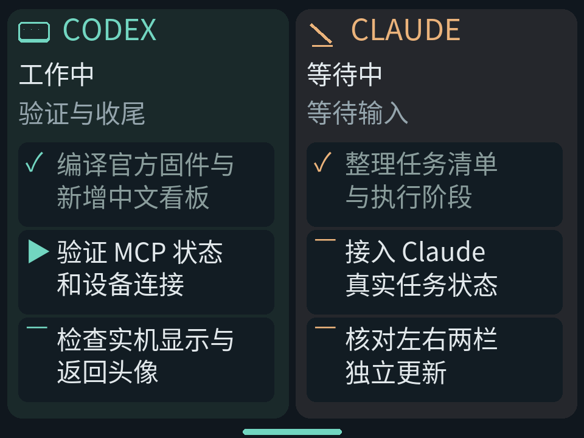

# StackChan · Agent 待办看板

基于 M5Stack 官方固件扩展：在独立 `AGENT TASKS` 菜单中，左侧显示 Codex、右侧显示 Claude 的状态、阶段与待办，支持进行中优先排序、转圈图标和动态省略号。

- [中文安装与使用说明](docs/agent-tasks-setup.zh-CN.md)
- [验证记录与已知限制](docs/agent-tasks-validation.zh-CN.md)
- `firmware/`：官方 ESP-IDF / Mooncake 固件及看板 App。
- `gateway/`：独立 Python MCP 网关与 Agent 适配器，读取本机会话状态，经 MCP 更新快照。
- `scripts/`：macOS 常驻服务安装与本机固件默认配置脚本。

设备通过 Wi-Fi HTTP 拉取快照；网关的其它 WebSocket 设备控制功能面向其上游替代固件，本项目官方固件不提供那些设备控制功能。公开源码不含个人令牌。网关源码及第三方许可见 [gateway/LICENSE](gateway/LICENSE) 与 [gateway/LICENSE-THIRD-PARTY](gateway/LICENSE-THIRD-PARTY)。

以下保留官方项目介绍。

# StackChan Open-Source

Here are StackChan related open-source resources, including source code of the StackChan firmware, remote controller firmware, mobile app (iOS and Android), and server. 

Update of this repo could be a little late than the released firmware and mobile app. 

----

**StackChan is a super kawaii AI desktop robot co-created by M5Stack and the user community.** It uses the M5Stack **flagship IoT development kit [CoreS3](https://docs.m5stack.com/en/core/CoreS3)** as its main controller, powered by an ESP32-S3 SoC featuring a 240 MHz dual-core processor, with 16MB Flash and 8MB PSRAM onboard, and supporting Wi-Fi and BLE. The main unit also integrates a 2.0-inch capacitive touch display with a high-strength glass cover, a 0.3 MP camera, a proximity & ambient light sensor, a 9-axis IMU (accelerometer + gyroscope + magnetometer), a microSD card slot, a 1W speaker, dual microphones, and power/reset buttons. 

The **robot body**, connected to the main unit, includes a USB-C interface for power and data, a 550 mAh battery, two feedback servos (360-degree continuous rotation on the horizontal axis and 90-degree movement on the vertical axis), two rows totaling 12 RGB LEDs, infrared transmitter and receiver, a three-zone touch panel, and a full-featured NFC module. 

The **factory firmware** is feature-rich, including an AI Agent, lively and expressive animations, ESP-NOW wireless remote control, and online app downloads. It can connect to a mobile app for video viewing, remote avatar control, and more, and also supports online updates (OTA). The product also supports programming via Arduino, UiFlow2, and other methods, and can connect to various expansion units in the M5Stack ecosystem, making it easy to implement a wide range of custom functions. 

> ⚠️ Do not forcibly rotate any movable parts connected to the motors by hand when you are unsure whether the motors are powered and under control, as this may cause hardware damage. 

- Purchase link: [M5Stack Official Store](https://shop.m5stack.com/products/stackchan-kawaii-co-created-open-source-ai-desktop-robot) | [淘宝 Taobao](https://item.taobao.com/item.htm?id=1042238294510)

- Product document page: [English](https://docs.m5stack.com/en/StackChan) | [日本語](https://docs.m5stack.com/ja/StackChan) | [中文](https://docs.m5stack.com/zh_CN/StackChan)

- Board support package: https://github.com/m5stack/StackChan-BSP

Thank you to the contributors of the StackChan community, especially: 

|  |  |
| -------------------------------------------------------------------------------- | --------------------------------------------------------------------------- |
| [@stack_chan](https://x.com/stack_chan)                                          | [@mongonta555](https://x.com/mongonta555)                                   |
| Shinya Ishikawa                                                                  | Takao Akaki                                                                 |
