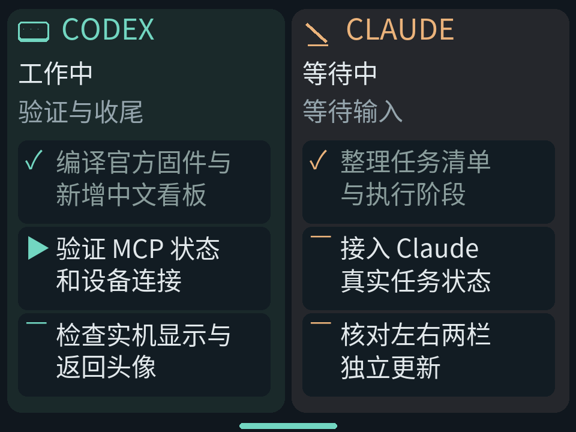

# Agent 待办看板配置说明

看板左栏显示 Codex，右栏显示 Claude。StackChan 通过 HTTP 读取 `stackchan-mcp` 网关的状态快照；网关地址和 Bearer 令牌在设备设置页配置。界面显示状态、阶段和任务标题，不显示提示词、对话正文、文件路径或工具参数。

## 启动共享网关

本仓库 `gateway/` 包含已扩展的独立 Python MCP 网关、Codex/Claude 适配器与测试。上游为 [kisaragi-mochi/stackchan-mcp](https://github.com/kisaragi-mochi/stackchan-mcp)；请从本仓库安装，PyPI 的上游版本未必包含看板接口。

### macOS 自动启动

先安装 Python 3.12 与 `uv`，在本仓库根目录执行（替换为电脑实际局域网 IPv4）：

```bash
python3 scripts/install-agent-dashboard-macos.py --host-ip 192.168.1.20
```

安装器依据 `gateway/uv.lock` 安装到 `~/.local/share/stackchan-agent-dashboard/.venv`，注册网关、Codex、Claude 三个 LaunchAgent。随机令牌保存在 `~/.config/stackchan-agent-dashboard/设备连接信息.txt`（仅本人可读写）；重新安装保留令牌。日志在 `~/Library/Logs/StackChanAgentDashboard/`。修改源码或电脑 IP 后重新运行安装器，更新设备配置。

安装器不修改 Codex 或 Claude 的全局配置，也不发起模型请求。停止服务：

```bash
launchctl bootout gui/$(id -u)/io.stackchan.agent-dashboard.codex
launchctl bootout gui/$(id -u)/io.stackchan.agent-dashboard.claude
launchctl bootout gui/$(id -u)/io.stackchan.agent-dashboard.gateway
```

如需永久取消登录启动，再移除对应的 `~/Library/LaunchAgents/io.stackchan.agent-dashboard.*.plist`。

### 手动启动

在仓库 `gateway/` 中执行以下命令（适用于 zsh；令牌需提前生成并在设备与客户端保持一致）：

```bash
cd gateway
export MCP_HTTP_HOST=0.0.0.0 MCP_HTTP_PORT=8767
export MCP_HTTP_ALLOWED_HOSTS='192.168.1.20'
export HOST=127.0.0.1 WS_PORT=18765 CAPTURE_PORT=18766
read -s 'STACKCHAN_TOKEN?输入网关令牌：'
export STACKCHAN_TOKEN
uv run --locked stackchan-mcp serve --transport streamable-http --no-mdns
```

Codex 和 Claude Code 应连接同一个网关的 `http://<电脑局域网地址>:8767/mcp`，并使用相同 Bearer 令牌。StackChan 使用 `http://<电脑局域网地址>:8767` 作为基础地址，读取受令牌保护的 `GET /agent-dashboard`。不要把网关暴露到公网，也不要将令牌提交到仓库。

## 配置 StackChan

公开源码不包含个人网关地址或令牌。设备连上 Wi-Fi 后，在 Launcher 的 `SETUP` → `Apps` → `Agent 看板` 中分别设置地址和访问令牌，点“测试”确认连接，再点“保存”。地址只填写基础 URL，例如 `http://192.168.1.20:8767`，不要附加 `/mcp` 或 `/agent-dashboard`。令牌必须与网关的 `STACKCHAN_TOKEN` 相同。已有个人定制固件也可能预置本机默认值；默认值不会随本仓库发布。


设备应与网关处于可互相访问的网络。`localhost` 指设备本身，不能用来连接电脑。网关快照端点为 `GET /agent-dashboard`，须带相同 Bearer 令牌。

### 可选：生成本机固件默认值

macOS 安装器执行后，可在本仓库根目录运行：

```bash
python3 scripts/configure-agent-dashboard-firmware.py
```

脚本读取本机配置，生成权限为 `0600` 的 `firmware/main/apps/app_agent_tasks/agent_tasks_local_defaults.h`，不打印令牌。该文件被 Git 忽略；随后重新构建的个人固件会回填空配置，保留 NVS 中已有非空值。没有此文件也可正常构建，通过设备设置页配置即可。含默认令牌的个人固件也应仅供本人使用。

## 状态和待办数据

每栏按“进行中 → 待办 → 已完成”稳定排序，同状态保持来源顺序。Claude 的任务超过 12 项时，先排序再选择可见任务，避免正在执行的任务被截掉。工作且在线时显示转圈、动态省略号与进行中标记轻微闪动；等待输入时显示动态省略号；完成、离线或过期后停止动画。


Agent 通过 MCP 工具 `agent_update_snapshot` 更新自己的状态。任务按 pending、in_progress、completed 显示；Agent 状态包括 idle、working、waiting、completed、failed。网关在 45 秒未收到心跳后将来源标记为过期，仍保留最后任务。

Codex Desktop rollout 监视器是可选的本机实验适配器。它仅处理 `originator` 明确为 `Codex Desktop` 的 rollout，读取回合开始、完成、中断事件，不读消息正文。启动方式：

```bash
cd /path/to/StackChan/gateway
export STACKCHAN_MCP_URL=http://127.0.0.1:8767/mcp
read -s 'STACKCHAN_TOKEN?输入与网关相同的令牌：'
export STACKCHAN_TOKEN
uv run python -m stackchan_mcp.agent_adapters.runner codex-watch
```

已检查的真实 Codex Desktop rollout 含 `task_started`、`task_complete`、`turn_aborted` 事件，但未包含计划清单。适配器自动汇报工作状态；待办使用下面的显式计划入口。`CODEX_SESSIONS_DIR` 可指定其他本机会话目录。使用 macOS 安装器后无需重复启动该监视器。

### Codex 计划同步

本仓库 AGENTS.md 已要求 Codex 主会话在计划变化时同步待办。其他项目可把同一段“StackChan 待办同步”说明加入自己的 AGENTS.md。以下命令应从需要展示的 Codex 主会话执行，自动采用该会话的 `CODEX_THREAD_ID`：

```bash
~/.local/share/stackchan-agent-dashboard/.venv/bin/python \
  -m stackchan_mcp.agent_adapters.runner codex-plan <<'JSON'
{"stage":"设备验证","plan":[{"step":"完成固件构建","status":"completed"},{"step":"验证实机显示","status":"in_progress"},{"step":"验证蓝牙连接","status":"pending"}]}
JSON
```

每次提交替换此会话的完整待办，最多 12 项；空列表清空。也可显式传 `session_id`，必须是需要展示的真实 Codex 主会话 ID。计划在本机以仅用户可读写的文件原子保存，监视器约 0.5 秒内读取并经 MCP 推送；设备再按 1 秒周期拉取。计划与自动生命周期使用同一个上报来源，心跳不会清空任务；其他会话不继承此清单。已结束回合显示“已完成”，未完成的任务仍按原状态保留。

这依赖 Codex 按项目说明主动同步计划，不是从聊天正文猜测任务，也不是已验证的桌面原生计划事件订阅。

Claude Code 使用本地 transcript 增量监视器，无需安装 Hook：

```bash
cd /path/to/StackChan/gateway
export STACKCHAN_MCP_URL=http://127.0.0.1:8767/mcp
# STACKCHAN_TOKEN 与网关一致
uv run python -m stackchan_mcp.agent_adapters.runner claude-watch
```

默认读取 `~/.claude/projects/*/*.jsonl`，可用 `CLAUDE_PROJECTS_DIR` 改目录。只展示最近活动的主会话，排除子 Agent；成功的 TaskCreate、TaskUpdate、TodoWrite 结果更新任务，结束回合保留清单。仅读取任务标题、状态和生命周期，不上传聊天正文、任务描述或工具参数。没有创建任务的会话显示“暂无待办任务”。`online` 表示监视器心跳正常，回放的已结束会话仍显示“已完成”，不代表模型正在执行。

Claude 的既有会话回放已通过监视器 → MCP → HTTP 验证，包括 12 项任务。请使用自己已安装的 Claude Code 正常工作；新会话需实际调用任务工具后才会有待办。新 Claude 会话实时任务生成仍待单独验收。使用 macOS 安装器后无需重复启动 transcript 监视器。

每栏采用完整快照；请为一个 Agent 只选择一个上报来源。若会话需手动调用 `agent_update_snapshot`，先停止对应监视器，以免监视器的下一次心跳覆盖手动待办。`claude-hook` 是保留的实验入口，当前推荐 transcript 方案。

## 验证与限制

- 网关需保持运行；Agent 和设备须能访问同一个服务。
- Codex 状态自动采集；待办由 Codex 显式计划同步入口提供，桌面原生计划事件仍未观察到。
- Claude 没有任务工具记录时，右栏清单为空；不会用旧会话任务填充新会话。
- StackChan 蓝牙广播不用于此功能；设备使用 Wi-Fi HTTP 读取看板。
- 网关或 Wi-Fi 暂时不可用时，设备保留最近一次成功取得的快照。

## 官方固件构建

使用本仓库 `firmware/` 的官方固件，目标为 ESP-IDF 6.1、BOARD_TYPE_M5STACK_STACK_CHAN、Quad PSRAM。先加载 ESP-IDF 6.1 环境，再执行：

```bash
cd firmware
python3 fetch_repos.py
idf.py build
```

生成 `firmware/build/stack-chan.bin`。不要使用 stackchan-mcp 上游仓库中的替代固件。

应用镜像写入 `0x20000`，大小必须小于 `0x4f0000`；常规刷写保留 NVS、分区表和 otadata。设备配置使用独立 NVS 命名空间 agent_tasks。若复位日志仍显示 DOWNLOAD(USB/UART0)，须松开下载按键并通过实体电源键关机再开机；镜像校验成功不代表已启动。

看板使用 SIL OFL 思源黑体衍生的 14 px 常用中文字库，支持 GB2312 常用字符。罕见汉字和 Emoji 建议改写为常用中英文。

界面布局预览（示例任务，非设备实拍）：
